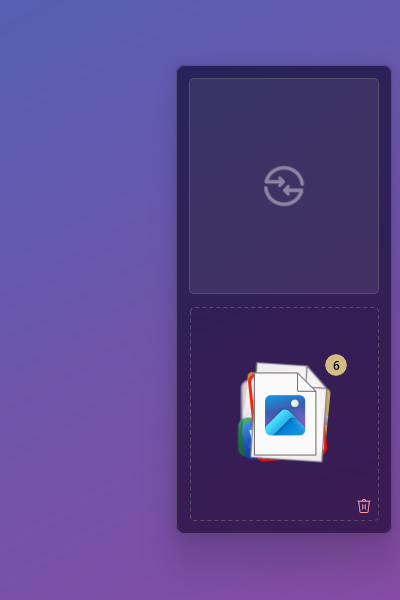
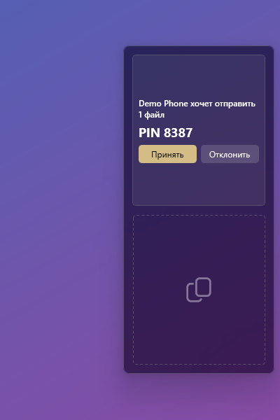
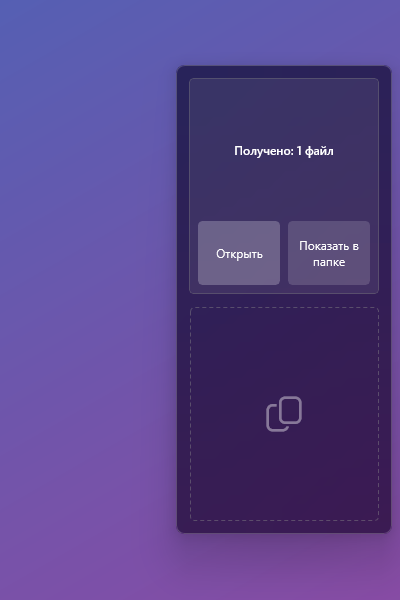
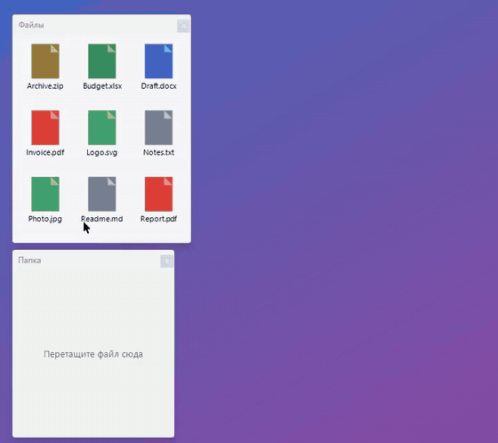
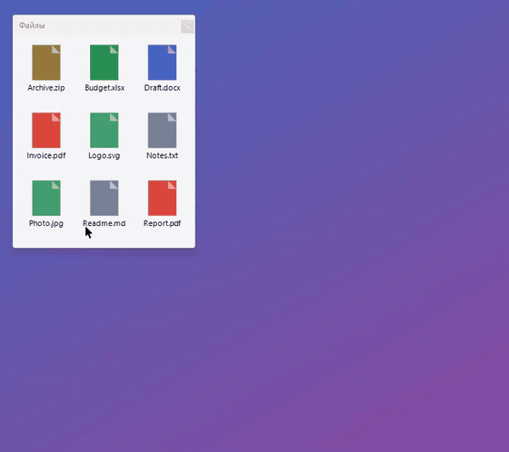
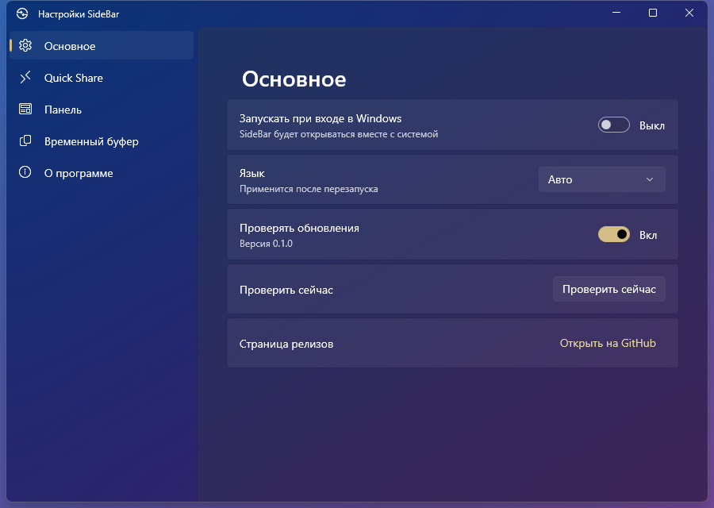

<div align="center">

# SideBar

**A slide-out panel for Windows 11: a drag-and-drop shelf and Quick Share with your Android phone — right at the screen edge.**

[Download](https://github.com/Denmurzik/SideBar/releases/latest) · [Русская версия](README.ru.md)

  

</div>

SideBar lives behind the right edge of your primary monitor. Nudge the mouse to the edge and an acrylic card slides out with a spring animation; move away and it hides again. It is a native WinUI 3 app compiled with NativeAOT, so it starts instantly and stays tiny in the background.

## Features

### Shelf — a temporary home for files you are moving

Drag files out of Explorer, a browser or Telegram, drop them on the card, switch apps, and drag them out where you need them. The stack shows up to 10 files (the shelf holds up to 100); click it to fan them out. Files from browsers and messengers are saved as real files so they can be dropped anywhere. The trash clears the shelf with a two-click confirmation, and your original files are never touched.



### Quick Share with Android

SideBar has its own implementation of Google's Quick Share protocol over Wi-Fi.

- **Send:** drop files on the Quick Share tile and pick a phone.
- **Receive:** an incoming request appears right in the card with the PIN and Accept / Decline. The card bounces (like a Dock icon) to get your attention.
- **Texts and links** from your phone go straight to the clipboard, with a one-click "Open link".
- **Your devices:** with the official Quick Share for Windows installed and signed in, SideBar uses its certificates. Your own phones are accepted without asking and marked "own", and SideBar can send to your phone **even when its screen is locked** (over Bluetooth, switching to Wi-Fi for large files). The certificates are refreshed automatically once a day.

 

### At the edge, out of the way


- The card peeks when the cursor is near the edge and opens when it touches it.
- It never steals focus and stays out of full-screen apps (except while you drag a file).
- A dashed drop zone, acrylic everywhere, light and dark themes.

### Settings



Start with Windows, language (Auto / English / Русский), update check, Quick Share visibility (Hidden / Your devices / Everyone for 10 min), this PC's name, the folder for received files, edge open delay, bounce, full-screen behaviour, shelf auto-cleanup and the path to the official Quick Share.

## Install

1. Download `SideBar-<version>-setup.exe` from [Releases](https://github.com/Denmurzik/SideBar/releases/latest) and run it. Administrator rights are needed: SideBar goes to `Program Files\SideBar`.
2. The installer adds a firewall rule, **"SideBar Quick Share"**: inbound TCP for `SideBar.exe` only, on **private** and **domain** networks only. Receiving files from a phone needs it. SideBar never listens on public networks.
3. For **Your devices**, install and sign in to the official [Quick Share for Windows](https://www.android.com/better-together/quick-share-app/) with the same Google account as your phone.

Close SideBar from the tray before updating. **Windows 11 only.**

**Uninstall:** Settings → Apps → Installed apps → SideBar → Uninstall. This removes the app, the firewall rule and the autostart entry. Your settings and shelf data stay in `%LOCALAPPDATA%\SideBar` and `HKCU\Software\SideBar`; delete them by hand if you want them gone.

## Privacy

- No accounts, no telemetry.
- Once a day SideBar makes an anonymous request to `api.github.com` (User-Agent `SideBar/<version>`) to see whether there is a new release. You can turn it off in Settings.
- The certificates of the official Quick Share app are read from disk into memory only. They are never copied, logged or sent anywhere.
- File names, texts and links are never written to the log.

## Build

- .NET SDK 10 (pinned in `global.json`)
- Visual Studio Build Tools with "Desktop development with C++" (for NativeAOT)

```
dotnet build tests/SideBar.Core.Tests -c Release
tests/SideBar.Core.Tests/bin/Release/net10.0-windows10.0.26100.0/SideBar.Core.Tests.exe
dotnet publish src/SideBar.App -c Release -p:Platform=x64 -o artifacts/app
```

Run the test projects as executables (xunit v3). The installer is built in CI; see [`installer/README.md`](installer/README.md).

| Path | What |
|---|---|
| `src/SideBar.Core` | UI-free logic: edge state machine, shelf, settings, update policy, localization |
| `src/SideBar.Nearby` | Quick Share protocol: UKEY2, Nearby Connections frames, mDNS, Bluetooth, certificates |
| `src/SideBar.App` | WinUI 3 app (unpackaged, NativeAOT) |
| `tests/`, `tools/` | tests, the UI automation driver, the Quick Share CLI, the official-app simulator |
| `docs/` | plan, research notes, milestone ledgers |

## License

[GPL-3.0](LICENSE). Third-party notices are in [NOTICE](NOTICE).

SideBar is an independent project and is not affiliated with Google. "Quick Share" and the Quick Share logo are trademarks of Google LLC.
